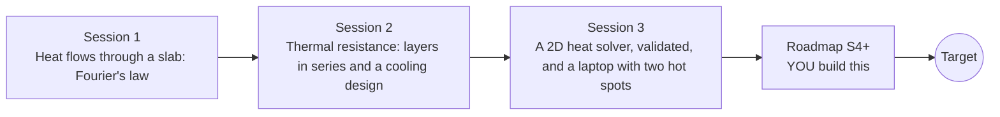

# openheatspread

[](https://github.com/KrunalPanchal1995/openheatspread/actions/workflows/ci.yml)   [](https://colab.research.google.com/github/KrunalPanchal1995/openheatspread/blob/main/sessions/session-01/lesson.ipynb) [](https://krunalpanchal1995.github.io/openheatspread/)

**Predict where a laptop gets hot, in three sessions.**

openheatspread teaches heat conduction from one slab to a 2D solver that finds laptop hot spots, using only Python and a browser.

- **Start from one slab.** Session 1 needs only school arithmetic; temperature, heat and Fourier's law are explained from scratch.
- **See it move.** Every session ships a slider app that runs in the browser, with labelled graphs.
- **Know you got it right.** Each session ends with a checkpoint that prints PASS or FAIL against hand calculations and exact solutions.
- **Build the missing half.** The repo stops at Session 3 on purpose; the roadmap shows the path to the Target.

[Target](#the-target) · [Who is this for](#who-is-this-for) · [Quick start](#quick-start) · [Sessions](#sessions) · [Roadmap](#roadmap) · [Contribute](#contribute) · [Explainer PDF](docs/explainer.pdf)

> **This repo is incomplete on purpose.** Sessions 1 to 3 are here and fully working. The finished Target below is a preview of what the community can build next. We show you the path, not the code. Sessions 4 and up are yours.

## The Target

A laptop board with a CPU and a GPU that switch on, load up and switch off. On the left, the bare board: the heat piles up under each chip and the peak reaches about 111 C. On the right, the same board with a thin copper heat spreader: the heat fans out sideways and the peak stays near 52 C. Your goal over the coming sessions: build the solver behind that right-hand picture yourself.


*Target: a laptop board with two hot spots, bare (left) and with a heat spreader (right)*


*CFD multiphysics project: conjugate heat transfer, temperature profile across a fluid and a solid meeting at an interface*


*CFD numerics teaching project: stability regions of time integrators (explicit schemes small, implicit schemes cover the left half-plane)*


*CFD numerics teaching project: an advection scheme is stable below CFL = 1 and blows up above it (same idea as our r limit)*

Try it live:

- [Math Visual Studio: partial differential equations (Atlas S18)](https://krunalpanchal1995.github.io/studio/#atlas?ch=S18&ex=1)
- [Math Visual Studio: heat diffusion project (Atlas S102)](https://krunalpanchal1995.github.io/studio/#atlas?ch=S102&ex=1)

How the Target was made is shown only as a path in [promo/roadmap.md](promo/roadmap.md).

## Who is this for
**higher secondary to diploma / undergraduate (levels 4-5).** Topic area: Heat, Thermodynamics and Fluid Mechanics.

Prerequisites:

- Arithmetic and reading a graph; the idea of temperature (school level).
- Python 3.10 or newer; if `python --version` works, you are ready. PRIMER.md explains the rest.
- No prior GitHub, calculus or numerical-methods experience is needed; Session 3 explains the few derivative ideas it uses.

New to Python? Read [PRIMER.md](PRIMER.md) first (10 minutes).

## Quick start

No installation knowledge needed. You need [Git](https://git-scm.com/downloads) and [Python 3.10+](https://www.python.org/downloads/) (Windows: tick "Add Python to PATH"). On Mac and Linux type `python3` wherever this page says `python`.

```bash
git clone https://github.com/KrunalPanchal1995/openheatspread.git
cd openheatspread
python start.py 1
```

`start.py` creates a private environment, installs what is needed and runs Session 1 with its checkpoint. Next: `python start.py 2`, `python start.py 3`, or `python start.py test` to check everything. Only a checkpoint: `python start.py check 1`.

Four lines turn the idea of Session 1 into a result (they work as they are): Save it as `try.py` and run it with `python start.py run try.py` (this uses the private environment, where NumPy is installed):

```python
import numpy as np
k, area, thickness = 5.0, 1e-4, 1e-3      # thermal pad: W/(m K), m^2, m
q = k * area * (80 - 50) / thickness       # Fourier's law, 80 C to 50 C
print(round(q, 1), 'W flows through the pad')   # -> 15.0 W
```

Every session also opens in your browser with sliders (no install): [live apps](https://krunalpanchal1995.github.io/openheatspread/). Or use the Colab badge above for the notebook.

## Sessions

| # | Session | Model level | Time | Live app |
|---|---|---|---|---|
| 1 | [Heat flows through a slab: Fourier's law](sessions/session-01/README.md) | Level 1: conceptual interactive model | 60 min | [open](https://krunalpanchal1995.github.io/openheatspread/session-01/) |
| 2 | [Thermal resistance: layers in series and a cooling design](sessions/session-02/README.md) | Level 2: mathematical engineering model | 75 min | [open](https://krunalpanchal1995.github.io/openheatspread/session-02/) |
| 3 | [A 2D heat solver, validated, and a laptop with two hot spots](sessions/session-03/README.md) | Level 3: simulation and validation | 90 min | [open](https://krunalpanchal1995.github.io/openheatspread/session-03/) |

Each session follows the same six steps: A real-world problem, B concept and theory, C visual explanation, D interactive simulation, E worked example and experiment, F assessment and design challenge. Each ends with `checkpoint.py`, which prints `PASS` or `FAIL` against reference numbers. Session 3 also contains the real-world mini-project: **Thermal budget for a laptop with two hot spots**.

## Architecture



| Folder or file | What is inside |
|---|---|
| `sessions/` | three sessions: README (A-F), `lesson.py`, notebook, live app, exercises, activity sheet, checkpoint |
| `promo/` | the Target: media, live links, and the roadmap (path only) |
| `docs/` | `explainer.tex` and the built `explainer.pdf` |
| `tests/` | runs every lesson and checkpoint headless |
| `start.py` | one command to set up and run anything |
| `QUALITY.md`, `RUBRIC.md` | the quality checklist and the scoring rubric |
| `.github/` | CI, PDF build, Pages deploy, issue and PR templates |

## Roadmap

| Milestone | What you will build | Difficulty |
|---|---|---|
| Session 4: An implicit solver with no step limit | A second solver that runs the Gaussian test with steps many times larger than the explicit limit. | intermediate |
| Session 5: A heat pipe between the chips and the edge | A board model with a high-conductance strip connecting the CPU to the board edge. | intermediate |
| Session 6: Go 3D: a stack of chip, board and spreader | The same validation in three dimensions with layers of different materials. | advanced |
| Session 7: Reproduce the Target: bare board against spreader | A transient simulation of two chips switching on and off and an animated heat map. | advanced |
| Session 8: Find the hot spots from a few sensors | A script that recovers CPU and GPU power from three noisy sensor readings. | advanced |

Full detail with a checkpoint per milestone: [promo/roadmap.md](promo/roadmap.md).

## Contribute
New to GitHub? Read [CONTRIBUTING.md](CONTRIBUTING.md); it starts from zero. Pick an issue labelled `good first issue`. Translations into Hindi, Telugu, Tamil and Malayalam are welcome.

<details>
<summary>Development</summary>

```bash
python start.py test        # runs every lesson and checkpoint
```
Lessons use `# %%` cell markers so they open as notebooks in VS Code. See [QUALITY.md](QUALITY.md) for the standard every session meets.
</details>

## License
MIT. See [LICENSE](LICENSE). Media in `promo/media` is (c) Krunal Panchal, CC BY 4.0.

## Acknowledgments
Part of the [PAN IIT OSS](https://hellofoss.tech-iitb.org/projects) open-source teaching collection, modelled on the structure of [openspline](https://github.com/openspline/openspline). Built on ideas from the Math Visual Studio at https://krunalpanchal1995.github.io/studio/.
