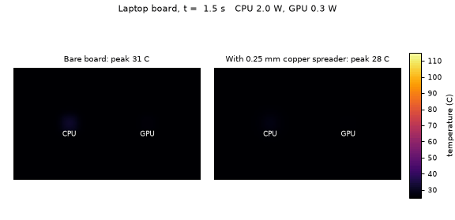
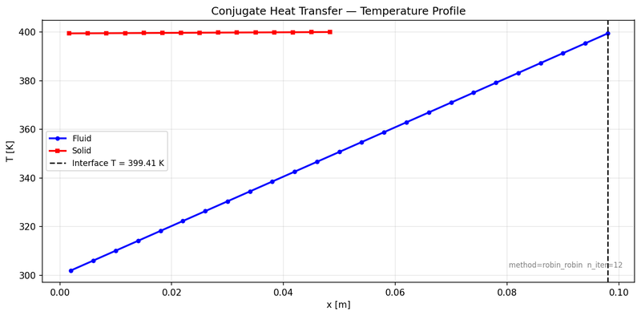
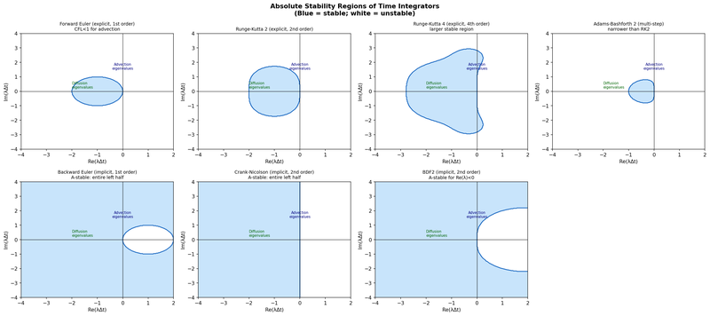
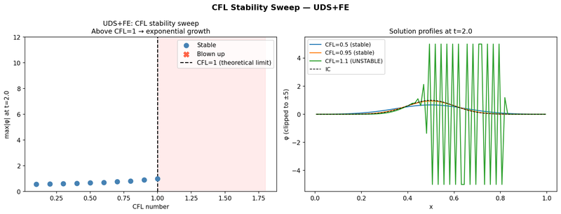

# What you are building toward

A laptop board with a CPU and a GPU that switch on, load up and switch off. On the left, the bare board: the heat piles up under each chip and the peak reaches about 111 C. On the right, the same board with a thin copper heat spreader: the heat fans out sideways and the peak stays near 52 C. Your goal over the coming sessions: build the solver behind that right-hand picture yourself.

*Target: a laptop board with two hot spots, bare (left) and with a heat spreader (right)*

*CFD multiphysics project: conjugate heat transfer, temperature profile across a fluid and a solid meeting at an interface*

*CFD numerics teaching project: stability regions of time integrators (explicit schemes small, implicit schemes cover the left half-plane)*

*CFD numerics teaching project: an advection scheme is stable below CFL = 1 and blows up above it (same idea as our r limit)*

These results come from a private reference build. The code is not published; the roadmap shows the path so you can build your own.

Live links:

- [Math Visual Studio: partial differential equations (Atlas S18)](https://krunalpanchal1995.github.io/studio/#atlas?ch=S18&ex=1)
- [Math Visual Studio: heat diffusion project (Atlas S102)](https://krunalpanchal1995.github.io/studio/#atlas?ch=S102&ex=1)
