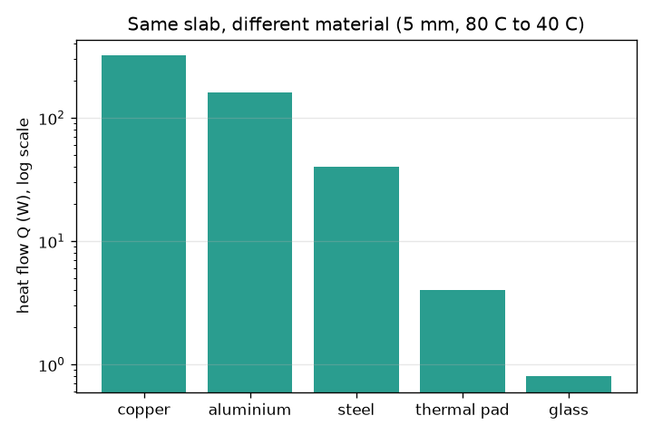
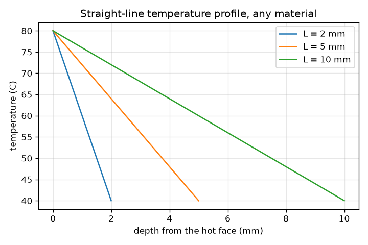

# Session 1: Heat flows through a slab: Fourier's law

*Level 1 (conceptual interactive model) · about 60 minutes · openheatspread*

> This is a simplified educational model. It is not a validated design tool and must not be used for real structures, electrical installations, vehicles, industrial processes or medical decisions.

**Prerequisites**

- Arithmetic with decimals and units; reading a straight-line graph.
- You have read PRIMER.md and run `python start.py 1` once.

**Learning objectives.** After this session you can:

- Explain that heat flows from hot to cold and that its rate is measured in watts.
- Use Q = k A (T_hot - T_cold) / L to compute the heat flow through a slab, by hand and in Python.
- Sketch the temperature profile inside a slab and explain why it is a straight line.
- Compare materials by their thermal conductivity.

## A. Real-world problem
The chip inside a laptop turns electricity into heat. The heat must get out through a thin pad into a metal heatsink, and the chip is safe only while it stays cool enough. How fast does heat move through a layer, how does the temperature change as you go through it, and why does a thin copper plate carry so much more heat than a slab of glass of the same size? This is general education about heat flow, not a design method for real products.

## B. Concept and theory
Heat is energy moving because of a temperature difference; it always flows from the hotter side to the colder side. In steady state (nothing changing with time) the heat flow through a flat slab is proportional to the area A, to the temperature difference between its faces, and to the material's thermal conductivity k, and inversely proportional to the thickness L. Because the same heat must cross every layer of the slab, the temperature falls at a constant rate, so the profile is a straight line from the hot face to the cold face. The line does not depend on k; k only decides how much heat the slab carries.

| Symbol | Meaning | Unit |
|---|---|---|
| Q | heat flow (heat per second) | W |
| k | thermal conductivity of the material | W/(m K) |
| A | area the heat passes through (1 cm^2 = 0.0001 m^2) | m^2 |
| T_hot, T_cold | temperatures of the two faces | C |
| L | slab thickness (heat travel distance) | m |
| q | heat flux, heat flow per unit area | W/m^2 |
| R | thermal resistance of the slab | K/W |

**Assumptions**

- Steady state: temperatures do not change with time.
- Heat flows in one direction only, straight through the slab (1D).
- k is constant, and the two faces are held at fixed temperatures.
- The faces are given temperatures, so large values of Q for good conductors are what the idealised model says, not what a real laptop could supply.

$$ Q=\frac{k\,A\,(T_{hot}-T_{cold})}{L} $$

$$ T(x)=T_{hot}-\left(T_{hot}-T_{cold}\right)\frac{x}{L},\qquad 0\le x\le L $$

$$ q=\frac{Q}{A}=\frac{k\,(T_{hot}-T_{cold})}{L},\qquad R=\frac{L}{kA} $$

## C. Visual explanation
The first figure shows the temperature against depth for three slab thicknesses with the same face temperatures: every line is straight, and the thicker the slab the gentler the slope. The second figure shows the heat flow for five materials through the same 5 mm, 1 cm^2 slab at 80 C and 40 C on a logarithmic scale: copper carries 320 W, aluminium 160 W, steel 40 W, a thermal pad 4 W and glass 0.8 W.

*Heat flow through the same slab in five materials (log scale): conductivity sets how much heat flows.*

*Temperature against depth for three slab thicknesses: always a straight line.*

## D. Interactive simulation
Run the lesson (`python start.py 1`), then open the live app: [Session 1: heat through a slab](https://krunalpanchal1995.github.io/openheatspread/session-01/) (or `app.html` in this folder). Move the thickness slider and watch the arrow and the straight temperature line change. Then change the conductivity and see that the heat flow Q changes but the temperature line does not.

**Challenge.** Make at least 100 W flow through a slab that is at least 5 mm thick.

## E. Worked example and experiment
**Problem.** A thermal pad (k = 5 W/(m K)) is 1 mm thick and covers 1 cm^2. Its hot face is at 80 C and its cold face at 50 C. Find the heat flow, the heat flux and the temperature half way through.

1. Convert to metres: L = 1 mm = 0.001 m, A = 1 cm^2 = 0.0001 m^2.
2. Q = k A (T_hot - T_cold) / L = 5 * 0.0001 * 30 / 0.001 = 15 W.
3. Flux q = Q / A = 15 / 0.0001 = 150000 W/m^2.
4. The profile is a straight line, so half way (x = 0.5 mm) the temperature is the average: (80 + 50) / 2 = 65 C.
5. Sanity check: 15 W is a reasonable laptop-chip power, and a 30 C drop across a pad this thin is what real pads show.

**Answer.** Q = 15 W, q = 150000 W/m^2 and the middle of the pad is at 65 C.

**Experiment.** Stack a thin plastic ruler or cardboard strip between a warm mug of water and a cold metal block and measure the face temperatures with two stick-on thermometers; with a heat flow you can estimate (a kettle's power, or the water cooling rate) you can estimate k. Expect a rough answer only: the model assumes steady flow, a single direction and perfect contact, while a real stack has air gaps and loses heat from its sides.

## F. Assessment and design challenge
**Question type A: Conceptual.** A slab of copper and a slab of glass have the same size and the same face temperatures. Which has the larger temperature drop per millimetre, and which carries more heat? Explain.

Hint

Think about what the profile depends on, and what Q depends on.

Step-by-step solution

Both have exactly the same straight-line profile: the drop per millimetre is (T_hot - T_cold) / L, which does not contain k. Copper carries far more heat, because Q is proportional to k (400 against about 1 W/(m K), so roughly 400 times more). The conductivity decides how much heat flows, not how the temperature is shaped.

**Question type B: Numerical.** A thermal pad with k = 5 W/(m K) is 0.5 mm thick and covers 1 cm^2, with faces at 70 C and 50 C. Find the heat flow in W and check that the answer is sensible.

Hint

Convert 0.5 mm and 1 cm^2 to metres first. Q = k A dT / L.

Step-by-step solution

Q = 5 * 0.0001 * 20 / 0.0005 = 20 W. Units: W/(m K) times m^2 times K divided by m gives W. Sanity check: compared with the worked example (15 W) the pad is half as thick, which would double the flow, but the temperature drop is smaller (20 K against 30 K), which cuts it by a third: 15 * 2 * 2/3 = 20 W.

**Question type C: Graph and simulation interpretation.** In the profile graph for L = 2, 5 and 10 mm (80 C to 40 C), what is the temperature at a depth of 2 mm in each slab, and what does that tell you about the slope?

Hint

Use T = 80 - 40 x / L. Remember the 2 mm slab ends at 2 mm.

Step-by-step solution

L = 2 mm: 80 - 40 * 2 / 2 = 40 C (the cold face). L = 5 mm: 80 - 16 = 64 C. L = 10 mm: 80 - 8 = 72 C. The slopes are 20, 8 and 4 C per mm: the thicker the slab, the more gently the temperature falls, because the same 40 C difference is spread over more distance.

**Question type D: Design and optimisation challenge.** Design: a pad (k = 5 W/(m K), 1 cm^2) must carry at least 12 W from a chip face at 80 C to a heatsink face at 50 C. Manufacturing says it cannot be thinner than 0.3 mm. Choose a thickness and justify it.

Hint

Rearrange the law: L = k A dT / Q gives the largest allowed thickness.

Step-by-step solution

Largest thickness: L = 5 * 0.0001 * 30 / 12 = 0.00125 m = 1.25 mm. So any thickness from 0.3 mm to 1.25 mm works. A choice of 0.5 mm carries 5 * 0.0001 * 30 / 0.0005 = 30 W, a comfortable margin. Trade-off: thinner pads carry more heat but are harder to make and to press flat on an uneven chip; thicker pads are forgiving but run out of margin at 1.25 mm.

Score yourself with [RUBRIC.md](../../RUBRIC.md). Print the [activity sheet](activity_sheet.md) to work on paper.

## Common misconceptions
| Common misconception | What is actually true |
|---|---|
| A good conductor makes the temperature fall quickly through it. | The steady profile is a straight line whatever k is. A good conductor just lets a lot of heat flow for the same temperature difference. |
| Heat and temperature are the same thing. | Temperature says how hot something is (C); heat is energy moving because of a temperature difference, measured as a rate in watts. |
| Doubling the thickness doubles the heat flow. | It halves it: heat flow is inversely proportional to the thickness. |

## Glossary
- **thermal conductivity (k)**: how well a material conducts heat, in W/(m K); copper about 400, air about 0.026
- **heat flow (Q)**: heat energy moving per second, in watts
- **heat flux (q)**: heat flow per unit area, in W/m^2
- **steady state**: a situation where temperatures no longer change with time
- **thermal resistance (R)**: how strongly a layer resists heat flow, in K/W; here L/(kA)
- **Fourier's law**: heat flow is proportional to area and temperature difference and inversely proportional to thickness

## Finish
1. Do the three coding tasks in [exercises.md](exercises.md).
2. Run `python start.py 1` again after your changes. It ends with the checkpoint; when it prints `PASS`, you are done. (Checkpoint only: `python start.py check 1`.)

Next: [Session 2](../session-02/README.md)
