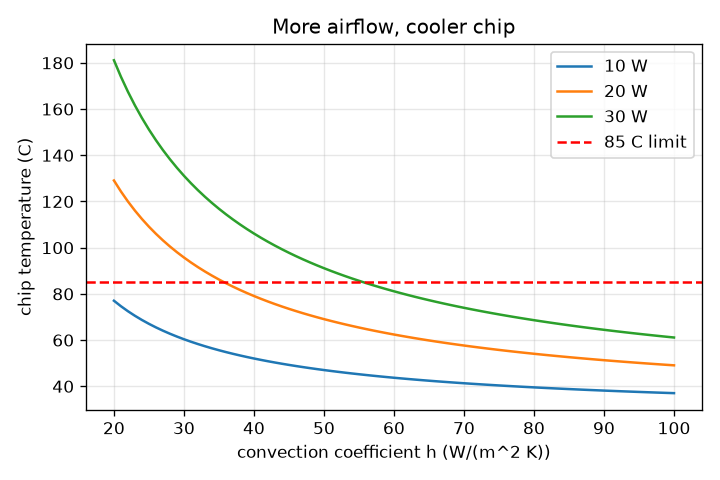
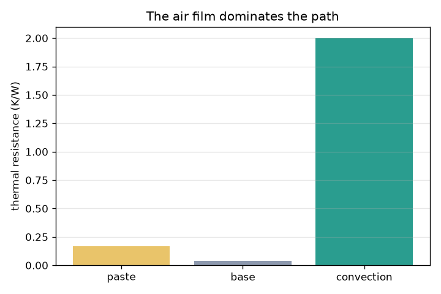

# Session 2: Thermal resistance: layers in series and a cooling design

*Level 2 (mathematical engineering model) · about 75 minutes · openheatspread*

> This is a simplified educational model. It is not a validated design tool and must not be used for real structures, electrical installations, vehicles, industrial processes or medical decisions.

**Prerequisites**

- Session 1: Fourier's law.
- Ohm's law (V = I R) is helpful: the maths is the same, explained again in Section B.

**Learning objectives.** After this session you can:

- Convert each layer of a heat path into a thermal resistance R = L/(kA) or R = 1/(hA).
- Add resistances in series and find the chip temperature T = T_ambient + P R_total.
- Find which layer dominates and which design change gives the largest drop in chip temperature.
- Solve the design problem: how much airflow keeps a chip below its limit?

## A. Real-world problem
A laptop chip dissipates 20 W. Its heat crosses a smear of thermal paste, an aluminium heatsink base and finally the air blown across the fins by a fan. The chip must stay below 85 C when the room is 25 C. If it runs too hot, what do you change: use copper instead of aluminium, make the base thicker, or spin the fan faster? Which one actually helps? This is a simplified model for learning, not a validated cooling design.

## B. Concept and theory
Rearranging Fourier's law gives dT = Q R, which looks like Ohm's law with temperature difference as voltage and heat flow as current. A conducting layer has R = L/(kA). Heat carried away by moving air obeys Newton's law of cooling, Q = h A dT, so the film of air has R = 1/(hA). When the same heat Q = P passes through layers one after another, the resistances add. The chip (junction) temperature is the ambient temperature plus P times the total resistance, and the temperature drop across each layer is P times that layer's resistance.

| Symbol | Meaning | Unit |
|---|---|---|
| P | chip power (all of it becomes heat) | W |
| T_amb | air temperature (25 C) | C |
| R_paste, R_base, R_air | thermal resistances of paste, base and the air film | K/W |
| h | convection coefficient: how well moving air carries heat off a surface | W/(m^2 K) |
| A_base | base area (20 mm x 20 mm = 4 cm^2) | m^2 |
| A_fins | total fin surface touched by air (100 cm^2, assumed) | m^2 |
| L, k | base thickness and conductivity | m, W/(m K) |
| T_chip | chip temperature | C |

**Assumptions**

- Steady state and a single path: all heat goes from the chip through paste, base and fins to air.
- The base area is 4 cm^2 and the chip heat is assumed to spread evenly over it (no sideways spreading).
- The fins are one lumped area of 100 cm^2 at the base temperature, with constant h.
- Paste: 0.2 mm thick, k = 3 W/(m K). Ambient air at 25 C.

$$ R_{cond}=\frac{L}{k\,A},\qquad R_{conv}=\frac{1}{h\,A} $$

$$ R_{total}=R_{paste}+R_{base}+R_{air},\qquad T_{chip}=T_{amb}+P\,R_{total} $$

$$ h_{min}=\frac{1}{A_{fins}\left(\dfrac{T_{max}-T_{amb}}{P}-R_{paste}-R_{base}\right)} $$

## C. Visual explanation
The first figure is a bar chart of the three resistances of the worked example: paste 0.167 K/W, base 0.038 K/W and the air film 2.000 K/W. The air film is 91 percent of the total. The second figure plots the chip temperature against the convection coefficient for chip powers of 10, 20 and 30 W with the 85 C limit marked: the curves fall steeply at low airflow and flatten at high airflow because R_air = 1/(hA) shrinks more slowly as h grows.

*Chip temperature against convection coefficient for 10, 20 and 30 W, with the 85 C limit.*

*The three resistances in the worked example: the air film dominates.*

## D. Interactive simulation
Run the lesson (`python start.py 2`), then open the live app: [Session 2: chip cooling stack](https://krunalpanchal1995.github.io/openheatspread/session-02/) (or `app.html` in this folder). Change the chip power, the airflow h, the base thickness and the base conductivity one at a time and watch the chip temperature. Which slider moves it the most? Then open the airflow graph and find where each setting crosses the 85 C line.

**Challenge.** Keep the chip at or below 70 C while it dissipates at least 30 W.

## E. Worked example and experiment
**Problem.** A 20 W chip sits on 0.2 mm of paste (k = 3 W/(m K)) and a 3 mm aluminium base (k = 200 W/(m K)), both over 4 cm^2. Air with h = 50 W/(m^2 K) cools 100 cm^2 of fins at 25 C. Find the chip temperature and the temperature at each interface.

1. R_paste = 0.0002 / (3 * 0.0004) = 0.1667 K/W.
2. R_base = 0.003 / (200 * 0.0004) = 0.0375 K/W.
3. R_air = 1 / (50 * 0.01) = 2.0000 K/W. R_total = 0.1667 + 0.0375 + 2.0000 = 2.2042 K/W.
4. T_chip = 25 + 20 * 2.2042 = 69.08 C.
5. Drops: paste 20 * 0.1667 = 3.33 K (chip 69.08 C to 65.75 C), base 20 * 0.0375 = 0.75 K (to 65.00 C), air 20 * 2.0 = 40 K (to 25 C).
6. Sanity check: the drops 3.33 + 0.75 + 40 = 44.08 K add up to 69.08 - 25.

**Answer.** The chip is at 69.08 C; the fins are at 65.00 C. The air film takes 40 K of the 44 K total.

**Experiment.** Run a computer under a steady load, record the chip temperature from the system monitor, then repeat with the fan forced to a high speed (or point a desk fan at it). The temperature change you see is larger than any change you would get from a different metal, as the model says. The model's numbers will not match your laptop because heat spreads sideways, fins are not one lump, h changes with fan speed and the chip is a small spot on the package.

## F. Assessment and design challenge
**Question type A: Conceptual.** The thermal paste is only 0.2 mm thick and the base is 3 mm thick, yet the air film has far more resistance than either. Why?

Hint

Compare L/(kA) with 1/(hA): which has a small number in the denominator?

Step-by-step solution

R = 1/(hA) uses h of only 50 W/(m^2 K) on 0.01 m^2, a product of 0.5 W/K, while the base has k A / L = 200 * 0.0004 / 0.003 = 27 W/K. Moving air is a very weak heat road compared with solid metal, even though the film has no thickness in the model. That is why the air side usually dominates and why designers add fins (bigger A) and fans (bigger h).

**Question type B: Numerical.** A 15 W chip sits on the same paste and a 4 mm copper base (k = 400), with h = 40 W/(m^2 K) on 100 cm^2 of fins. Find the chip temperature.

Hint

Compute the three resistances, add them, then T = 25 + P R_total.

Step-by-step solution

R_paste = 0.1667 K/W. R_base = 0.004 / (400 * 0.0004) = 0.025 K/W. R_air = 1 / (40 * 0.01) = 2.5 K/W. R_total = 2.6917 K/W. T_chip = 25 + 15 * 2.6917 = 65.4 C. Sanity check: R_total is slightly larger than R_air alone (2.5), as it must be.

**Question type C: Graph and simulation interpretation.** On the airflow graph for 10, 20 and 30 W, which of those chips stay below 85 C at h = 50 W/(m^2 K)? Roughly where does the 30 W curve cross 85 C?

Hint

Evaluate T = 25 + P * 2.2042 at the three powers and read the 30 W crossing from the graph.

Step-by-step solution

At h = 50: 10 W gives 47.0 C, 20 W gives 69.1 C and 30 W gives 91.1 C. So 10 and 20 W stay below 85 C and 30 W does not. The 30 W curve crosses 85 C near h = 56 W/(m^2 K) (the design formula gives 55.7).

**Question type D: Design and optimisation challenge.** Design: a 30 W chip must stay at or below 85 C with the 3 mm aluminium base and h = 50. (a) Find the smallest h that works. (b) Would switching to a copper base (k = 400) be enough instead? (c) Suggest a design and a trade-off.

Hint

For (a) use the h_min formula. For (b) recompute R_base and T_chip at h = 50.

Step-by-step solution

(a) Allowed total R = (85 - 25) / 30 = 2.0 K/W, so R_air <= 2.0 - 0.1667 - 0.0375 = 1.7958 K/W and h >= 1 / (1.7958 * 0.01) = 55.7 W/(m^2 K). (b) With copper R_base = 0.01875 and R_total = 2.1854 K/W, so T = 25 + 30 * 2.1854 = 90.6 C (aluminium gives 91.1 C): still above 85 C, copper only gains 0.6 K. (c) Raise h to about 60 (a faster fan), or add fins to raise A_fins; or throttle the chip power to 27 W (max power of the original cooler at 85 C is 27.2 W). Trade-offs: a faster fan costs noise and battery; more fins cost size and weight; throttling costs performance. Keep a safety margin because the model is simplified.

Score yourself with [RUBRIC.md](../../RUBRIC.md). Print the [activity sheet](activity_sheet.md) to work on paper.

## Common misconceptions
| Common misconception | What is actually true |
|---|---|
| A thicker or better metal base is the best way to cool a chip. | The base resistance is tiny next to the air film; the air side (h and fin area) dominates in this model. Spreading heat sideways does matter in real chips, and that is Session 3. |
| Thermal resistances add only for layers that are the same size. | They add for any layers that carry the same heat flow in series; each one is computed from its own k, L and A. |
| The temperature drops equally across every layer. | The drop across a layer is P times its resistance, so the layer with the largest R takes the largest drop. |

## Glossary
- **thermal resistance**: temperature difference needed to push 1 W through a layer, in K/W
- **series**: layers arranged one after another so that the same heat crosses each of them
- **convection**: heat carried away by a moving fluid such as air
- **convection coefficient (h)**: how many watts per square metre per kelvin the air removes, in W/(m^2 K)
- **junction temperature**: the temperature of the chip itself, the number that must stay below the limit
- **thermal interface material**: paste or pad that fills tiny air gaps between chip and heatsink

## Finish
1. Do the three coding tasks in [exercises.md](exercises.md).
2. Run `python start.py 2` again after your changes. It ends with the checkpoint; when it prints `PASS`, you are done. (Checkpoint only: `python start.py check 2`.)

Next: [Session 3](../session-03/README.md)
