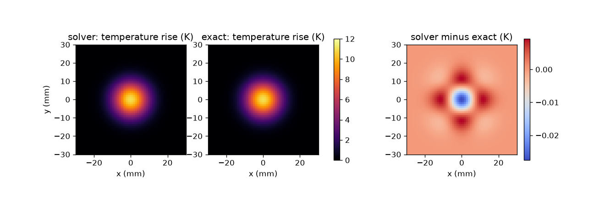
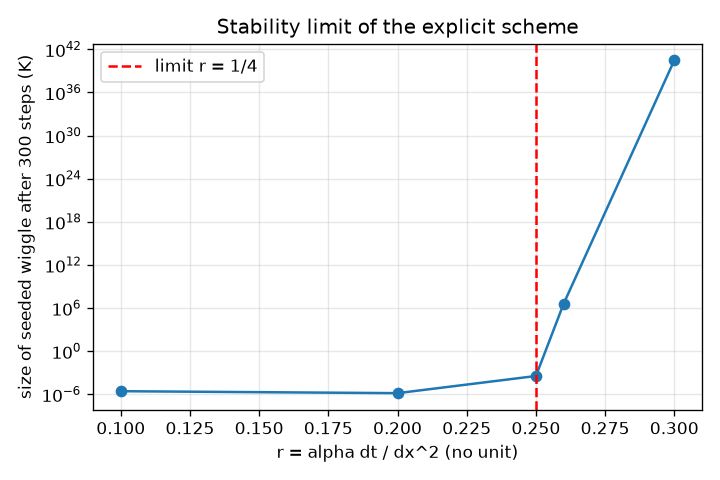
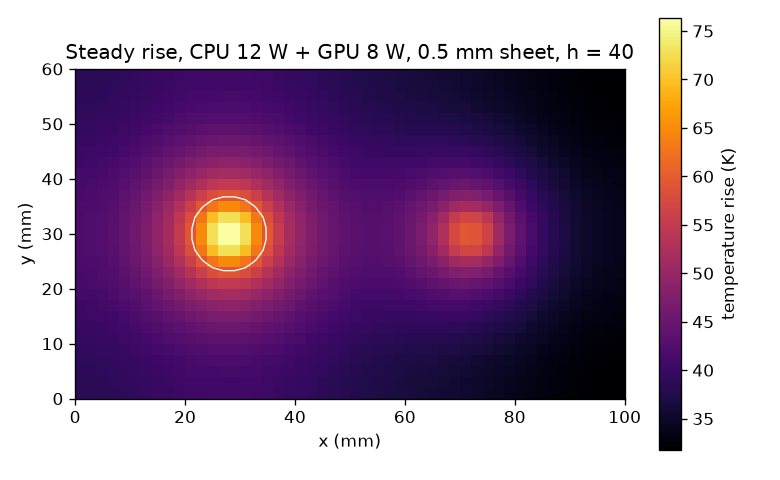
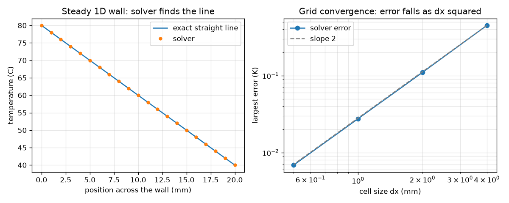

# Session 3: A 2D heat solver, validated, and a laptop with two hot spots

*Level 3 (simulation and validation) · about 90 minutes · openheatspread*

> This is a simplified educational model. It is not a validated design tool and must not be used for real structures, electrical installations, vehicles, industrial processes or medical decisions.

**Prerequisites**

- Session 1: Fourier's law.
- Session 2: thermal resistance (helpful for the cooling term).
- Python arrays: indexing and loops. The few derivative ideas are explained in Section B.

**Learning objectives.** After this session you can:

- Explain how the explicit finite-difference update works and why dt <= dx^2 / (4 alpha) in 2D.
- Validate a solver against two exact cases: a steady 1D wall and a spreading Gaussian hot spot.
- Measure grid convergence and sensitivity to conductivity, and show what happens past the stability limit.
- Apply the validated solver to a board with two hot spots and check the energy balance.

## A. Real-world problem
A laptop board has a CPU and a GPU that each create a small, intense hot spot. Metal under the board spreads the heat sideways and the fan carries it off the faces. Session 2 could only say 'heat flows through a layer'; it cannot say where the hot spots are or how they evolve in time. Can you write a small solver that predicts the temperature everywhere on the board, and how do you know it can be trusted? This is a simplified educational model, not a design tool for real products.

## B. Concept and theory
In a thin sheet, the temperature changes with time according to the diffusion (heat) equation: the rate of change of T equals the thermal diffusivity alpha times the sum of the second derivatives of T in x and in y. The second derivative measures how much a point differs from the average of its neighbours. On a grid of square cells of size dx, the explicit update moves each cell a fraction r = alpha dt / dx^2 of the way toward the average of its four neighbours. If r is larger than 1/4 a cell overshoots the average and the errors grow every step; so dt must not exceed dx^2 / (4 alpha). Heat sources add a term P / (rho c V) in K/s, and cooling of the two faces by air subtracts a term 2 h T / (rho c d). Validation means comparing against cases with exact answers: a steady wall (straight-line profile) and a Gaussian hot spot, whose exact solution in an unbounded sheet stays Gaussian with width squared s0^2 + 2 alpha t.

| Symbol | Meaning | Unit |
|---|---|---|
| T | temperature rise above room temperature | K |
| alpha | thermal diffusivity k / (rho c); aluminium about 82 mm^2/s | mm^2/s |
| dx, dt | cell size and time step | mm, s |
| r | stability number alpha dt / dx^2 | no unit |
| A, s0 | initial peak rise (60 K) and width (3 mm) of the Gaussian hot spot | K, mm |
| P | chip power | W |
| rho c | volumetric heat capacity of the sheet (aluminium 2.43e6) | J/(m^3 K) |
| d, h | sheet thickness and convection coefficient | mm, W/(m^2 K) |

**Assumptions**

- A thin sheet, so temperature does not vary through its thickness (2D).
- Edges are insulated; heat leaves only through the two faces via a constant h.
- Constant material properties; temperatures are rises above room temperature.
- Chips are 8 mm squares dissipating power uniformly into the sheet; no heat pipes, no package, no 3D effects.
- For the Gaussian test, the sheet is wide enough (80 mm) that the edges do not matter.

$$ \frac{\partial T}{\partial t}=\alpha\left(\frac{\partial^2 T}{\partial x^2}+\frac{\partial^2 T}{\partial y^2}\right) $$

$$ T^{n+1}_{i,j}=T^{n}_{i,j}+r\left(T_{i-1,j}+T_{i+1,j}+T_{i,j-1}+T_{i,j+1}-4T_{i,j}\right),\quad r=\frac{\alpha\,\Delta t}{\Delta x^2}\le\frac14 $$

$$ T(x,y,t)=A\,\frac{s_0^2}{s_0^2+2\alpha t}\exp\!\left(-\frac{x^2+y^2}{2\,(s_0^2+2\alpha t)}\right) $$

$$ \frac{\partial T}{\partial t}=\alpha\nabla^2T+\frac{P}{\rho c\,V}-\frac{2h}{\rho c\,d}\,T $$

## C. Visual explanation
The first figure shows the solver and the exact Gaussian hot spot side by side after 1 s, and their difference, which is below 0.03 K. The second shows the 1D wall test (the solver lands on the straight line) and a log-log plot of the largest error against the cell size: the points fall along a slope-2 line, so halving dx cuts the error by 4. The third plots the size of a tiny seeded wiggle against r: flat below 0.25 and exploding above it. The fourth is the steady temperature rise of the laptop board with the CPU and GPU spots and the hot-spot contours.

*A Gaussian hot spot after 1 s: solver, exact solution and their difference.*

*A seeded wiggle stays small for r up to 0.25 and explodes beyond it.*

*Steady temperature rise of the laptop board with a 12 W CPU and an 8 W GPU on a 0.5 mm aluminium sheet.*

*Left: the solver finds the exact straight line of a steady wall. Right: error against cell size falls along a slope-2 line.*

## D. Interactive simulation
Run the lesson (`python start.py 3`), then open the live app: [Session 3: 2D heat solver and its stability limit](https://krunalpanchal1995.github.io/openheatspread/session-03/) (or `app.html` in this folder). Raise the step number r above 0.25 and watch the checkerboard noise take over the heat map, then bring it back down. Change the diffusivity alpha and see the peak fall faster when alpha is larger. Open the centre-line view to compare the solver and the exact curve.

**Challenge.** Use the largest stable step (r between 0.24 and 0.25) with a material of diffusivity at least 40 mm^2/s.

## E. Worked example and experiment
**Problem.** For a material with alpha = 20 mm^2/s on a grid with dx = 1 mm, find the largest stable time step, then find the peak temperature rise of the 60 K, 3 mm Gaussian hot spot after 1 s, from the exact formula, and compare with the solver at r = 0.2.

1. dt_max = dx^2 / (4 alpha) = 1 / (4 * 20) = 0.0125 s. With r = 0.2 we use dt = 0.2 * 1 / 20 = 0.01 s, so 100 steps reach 1 s.
2. Exact width: s0^2 + 2 alpha t = 9 + 2 * 20 * 1 = 49 mm^2.
3. Exact peak = 60 * 9 / 49 = 11.02 K (the hot spot has dropped from 60 K to about 11 K by spreading).
4. The solver gives 10.99 K, a difference of 0.03 K (0.2 percent).
5. Sanity check: heat is conserved by the insulated edges, so as the peak falls the hot spot must become wider; the width went from 3 mm to 7 mm (sqrt 49).

**Answer.** dt_max = 0.0125 s; exact peak 11.02 K after 1 s; the solver gives 10.99 K.

**Experiment.** Put a drop of warm water (or touch a heated metal tip) on a thin sheet of paper or metal foil lying on a cool surface and film it with a phone camera, or a thermal camera if you have one: the hot spot grows wider and fainter, as the Gaussian does. The model differs from reality because real sheets lose heat to the air, are not perfectly uniform and the spot is not a perfect Gaussian, and a real camera blurs the picture.

## Real-world application and mini-project: Thermal budget for a laptop with two hot spots
A laptop has a 12 W CPU and an 8 W GPU on a 100 mm x 60 mm board backed by an aluminium spreader sheet. A fan gives h = 40 W/(m^2 K). The chips must stay at most 80 C when the room is 25 C, so the peak temperature rise must be at most 55 K. Use `peak_rise` and `board_run` from Session 3 to choose the sheet thickness. Aluminium weighs 2.7 g per cm^3 and the sheet may weigh at most 25 g. This is a simplified educational model, not a design tool.

**Deliverable:** A script that prints a table of sheet thickness (0.3 to 2.0 mm), peak rise and sheet mass, names your chosen thickness, and states the largest total power (CPU and GPU in the 12:8 ratio) that the chosen sheet can handle at the 55 K limit, using the fact that the model is linear in power.

**Success looks like:** Your chosen sheet has a peak rise of at most 55 K and a mass of at most 25 g, and the energy balance (power lost to the air equals power in) holds within 1 percent.

## F. Assessment and design challenge
**Question type A: Conceptual.** Why does the explicit scheme blow up when dt is too large, even though each step only moves a cell toward the average of its neighbours?

Hint

What happens if a cell moves MORE than the whole way to the average (r larger than 1/4 in 2D)?

Step-by-step solution

With r above 1/4 the new value overshoots the neighbour average, so the cell ends on the far side of it. The checkerboard error pattern is then multiplied by |1 - 8 r| each step, which is bigger than 1 when r is above 1/4 (1.4 at r = 0.30), so errors grow geometrically instead of fading. A finer grid makes the limit tighter because dt_max goes with dx^2.

**Question type B: Numerical.** Aluminium has alpha = 82.3 mm^2/s. Find the largest stable time step for dx = 0.5 mm. What happens to dt_max if you halve dx again?

Hint

dt_max = dx^2 / (4 alpha).

Step-by-step solution

dt_max = 0.25 / (4 * 82.3) = 0.00076 s (0.76 ms). Halving dx makes dx^2 four times smaller, so dt_max becomes 0.00019 s. In 2D that means four times more cells and four times more steps: sixteen times the work. Sanity check: a finer grid always needs a smaller step.

**Question type C: Graph and simulation interpretation.** In the convergence plot the largest errors are 0.449, 0.110, 0.0275 and 0.0069 K for dx = 4, 2, 1 and 0.5 mm. By what factor does the error shrink each time dx is halved? Predict the error at dx = 0.25 mm, then check with `max_error(0.25)`.

Hint

Divide each error by the next one.

Step-by-step solution

The ratios are 4.08, 4.00 and 4.00: the error falls by 4 each time dx is halved, so the method is second order (error proportional to dx^2). At dx = 0.25 mm the lesson's own run (`max_error(0.25)`, r = 0.2) gives 0.0017 K, a factor 4.0 below 0.0069 K, as expected for a second-order method.

**Question type D: Design and optimisation challenge.** Design: the CPU (12 W) and GPU (8 W) must stay at most 85 C in 25 C air (a rise of at most 60 K) with h = 40 W/(m^2 K). The 100 mm x 60 mm aluminium spreader sheet (2.7 g per cm^3) may not weigh more than 20 g. Using the printed table, choose a thickness and justify it.

Hint

The sheet is 60 cm^2, so mass = 60 * d(cm) * 2.7 g. Compare the peak rises in the table.

Step-by-step solution

The sheet is 60 cm^2, so mass = 60 * d(cm) * 2.7 g: 0.5 mm gives 8.1 g, 1.0 mm gives 16.2 g and 2.0 mm gives 32.4 g. At h = 40 the peak rises are 76.3 K (0.5 mm), 59.7 K (1.0 mm) and 50.9 K (2.0 mm). Only 1.0 mm meets both the 60 K limit and the 20 g limit, but it passes by only 0.3 K, which is too thin a margin for a simplified model. A better design raises h as well: at h = 80 the 1.0 mm sheet gives 38.2 K. Trade-off: a faster fan costs noise and battery; a thicker sheet costs weight.

Score yourself with [RUBRIC.md](../../RUBRIC.md). Print the [activity sheet](activity_sheet.md) to work on paper.

## Common misconceptions
| Common misconception | What is actually true |
|---|---|
| A solver that gives a nice-looking picture must be right. | Only comparison with an exact or trusted case, a convergence study and conservation checks show it is right. A blow-up or a smooth wrong answer can both look plausible. |
| A smaller time step is always better, so there is no stability problem. | A smaller step is safe for the explicit scheme but costs time; the limit dt <= dx^2 / (4 alpha) is what makes a step too large unsafe, and it tightens as the grid is refined. |
| The peak temperature of a hot spot depends on the power only. | It depends on how fast the sheet spreads the heat (conductivity and thickness) and how well the faces cool, as the board table shows. |

## Glossary
- **thermal diffusivity (alpha)**: k / (rho c): how fast a temperature change spreads through a material, in mm^2/s here
- **finite difference**: replacing derivatives by differences between neighbouring grid values
- **explicit scheme**: each new value is computed only from old values, which is simple but needs a small time step
- **stability limit**: the largest time step for which errors do not grow
- **grid convergence**: the error shrinks in a known way as the cell size is refined
- **validation**: checking a solver against exact results or trusted data
- **energy balance**: heat generated equals heat leaving at steady state

## Finish
1. Do the three coding tasks in [exercises.md](exercises.md).
2. Run `python start.py 3` again after your changes. It ends with the checkpoint; when it prints `PASS`, you are done. (Checkpoint only: `python start.py check 3`.)

Next: the [roadmap](../../promo/roadmap.md). Session 4 is yours to build.
